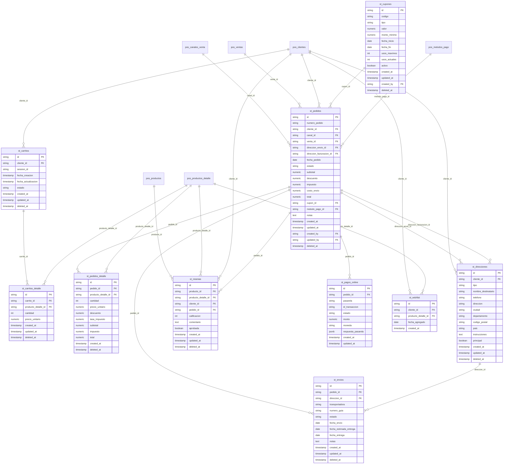

# Especificación del Módulo Tienda Virtual - Kubit

> **Estado real (2026-11-09):** este documento describe el alcance completo previsto de la tienda. Lo **implementado y vigente en produccion** esta en las secciones marcadas "(vigente)": §2.6, §3.4, §3.9, §3.10, §3.11, §3.12 y §5.3. Varias funciones descritas en otras secciones (carrito en DB, cuentas de cliente, pasarela integrada, cupones, reseñas, wishlist, descuento de inventario al pagar) **no estan implementadas** y algunas fueron descartadas por decision de negocio. Ante una contradiccion, prevalecen §5.1 de `AGENTS.md` y `apps/store/specs/hallazgos-tienda.md` (decisiones D1-D39).

## 1. Descripción General
El módulo **Store (Tienda Virtual)** es el componente de comercio electrónico del ecosistema Kubit. Permite la venta de productos a través de un catálogo público en línea, con carrito de compras, checkout, procesamiento de pagos y gestión de pedidos.

### 1.1 Alcance Funcional
- Catálogo de productos público con búsqueda y filtros
- Carrito de compras (persistente para registrados, localStorage para invitados)
- Checkout con y sin registro (guest checkout)
- Pasarela de pagos integrada
- Gestión de pedidos y seguimiento de envíos
- Panel de cliente (historial de pedidos, direcciones, wishlist)
- Cupones de descuento
- Reseñas y calificaciones de productos
- Lista de deseos (wishlist)
- SEO (URLs amigables, meta tags, sitemap)

### 1.2 Dependencias
- **Base de datos:** PostgreSQL vía Supabase (esquemas `pos_*` + `st_*`)
- **UI/UX:** Sistema de diseño definido en `05-ui-ux-system.md`
- **Arquitectura:** Estructura definida en `ARCHITECTURE.md`
- **Módulo POS:** Productos, categorías, clientes, métodos de pago y configuración se comparten desde `pos_*`
- **Pasarela de pagos:** API externa (definir en integraciones)

---

## 2. Modelo de Datos

### 2.1 Convenciones Generales
- **Prefijo:** Tablas de la tienda usan prefijo `st_`; tablas compartidas usan `pos_`
- **Primary Key:** `id` tipo `string` (UUID v4)
- **Timestamps:** `created_at` y `updated_at` tipo `timestamptz`
- **Soft Delete:** `deleted_at` nullable (`timestamptz`)
- **Auditoría:** `created_by` y `updated_by` como FK a `pos_usuarios`
- **Moneda:** Todos los montos son `numeric`
- **Índices:** Todas las FK deben tener índice para rendimiento en JOINs

### 2.2 Tablas Compartidas con POS (`pos_*`)

| Tabla | Uso en Store |
|---|---|
| `pos_productos` | Catálogo de productos (nombre, descripción, impuesto, marca, modelo) |
| `pos_productos_detalle` | Variantes del producto (precios, stock, código barras, imágenes) |
| `pos_productos_multimedia` | Imágenes y galería multimedia del catálogo |
| `pos_categorias` | Árbol de categorías para navegación y filtros |
| `pos_clientes` | Cuentas de clientes registrados en la tienda |
| `pos_metodos_pago` | Métodos de pago habilitados para el checkout |
| `pos_canales_venta` | Canal de venta asociado al pedido (web por defecto) |
| `pos_configuracion_empresa` | Información legal, términos, logo, redes sociales |
| `pos_usuarios` | Usuarios administradores de la tienda |
| `pos_roles` | Roles del sistema (administrador, moderador de reseñas) |
| `pos_rol_permisos` | Permisos para gestión de tienda |

> **Nota sobre el logo:** Actualmente el modulo Store usa un archivo estatico `img/LogoTodasPublicaciones.jpg` hardcodeado en `navbar-store.js`, `footer-store.js` y `sobre-nosotros.html`. NO se lee desde `pos_configuracion_empresa.logo_url`. Migracion futura pendiente.

### 2.3 Tablas Exclusivas del Store (`st_*`)

| Tabla | Propósito |
|---|---|
| `st_carritos` | Carritos de compra activos asociados a sesión o cliente |
| `st_carritos_detalle` | Productos agregados al carrito con cantidades |
| `st_pedidos` | Órdenes de compra realizadas |
| `st_pedidos_detalle` | Líneas de detalle de cada pedido |
| `st_direcciones` | Direcciones de envío y facturación de clientes |
| `st_envios` | Seguimiento de envíos con estado y número de tracking |
| `st_cupones` | Cupones de descuento con reglas de aplicación |
| `st_resenas` | Reseñas y calificaciones de productos |
| `st_pagos_online` | Transacciones contra la pasarela de pago |
| `st_wishlist` | Listas de deseos de los clientes |

### 2.4 Diagrama Entidad-Relación



### 2.5 Catálogo Detallado de Tablas `st_*`

#### 2.5.1 `st_carritos`
| Campo | Tipo | Descripción |
|---|---|---|
| `id` | string PK | UUID |
| `cliente_id` | string FK | Cliente registrado (null si es guest) |
| `session_id` | string | ID de sesión para carritos de invitados |
| `fecha_creacion` | timestamp | Momento de creación del carrito |
| `fecha_actualizacion` | timestamp | Última modificación |
| `estado` | string | `ACTIVO`, `CONVERTIDO`, `ABANDONADO` |
| `created_at` | timestamp | Auditoría |
| `updated_at` | timestamp | Auditoría |
| `deleted_at` | timestamp | Soft delete |

**Reglas:**
- Un carrito pertenece a un cliente registrado O a una sesión de invitado (nunca ambos vacíos)
- Estado `CONVERTIDO` cuando el carrito se transforma en pedido
- Estado `ABANDONADO` si no hay actividad por más de 7 días (para campañas de recuperación)

#### 2.5.2 `st_carritos_detalle`
| Campo | Tipo | Descripción |
|---|---|---|
| `id` | string PK | UUID |
| `carrito_id` | string FK | Carrito al que pertenece |
| `producto_detalle_id` | string FK | Variante del producto |
| `cantidad` | int | Cantidad seleccionada |
| `precio_unitario` | numeric | Precio al momento de agregar (snapshot) |
| `created_at` | timestamp | Auditoría |
| `updated_at` | timestamp | Auditoría |
| `deleted_at` | timestamp | Soft delete |

**Reglas:**
- `cantidad` debe ser > 0
- El `precio_unitario` se congela al agregar al carrito (no cambia si el precio sube después)
- Se valida `stock_actual` en `pos_productos_detalle` al momento de checkout

#### 2.5.3 `st_pedidos`
| Campo | Tipo | Descripción |
|---|---|---|
| `id` | string PK | UUID |
| `numero_pedido` | string | Correlativo público (ej. `KBT-202605-0001`) |
| `cliente_id` | string FK | Cliente que realizó el pedido |
| `canal_id` | string FK | Canal de venta (web, mercadolibre, etc.) |
| `venta_id` | string FK | Venta POS asociada (cuando el pedido se consolida) |
| `direccion_envio_id` | string FK | Dirección de envío seleccionada |
| `direccion_facturacion_id` | string FK | Dirección fiscal |
| `fecha_pedido` | date | Fecha del pedido |
| `estado` | string | Ver ciclo de vida abajo |
| `subtotal` | numeric | Suma de subtotales del detalle |
| `descuento` | numeric | Descuento total aplicado |
| `impuesto` | numeric | Impuesto total |
| `costo_envio` | numeric | Costo del envío |
| `total` | numeric | Total final = subtotal - descuento + impuesto + costo_envio |
| `cupon_id` | string FK | Cupón aplicado (opcional) |
| `metodo_pago_id` | string FK | Método de pago seleccionado |
| `notas` | text | Notas del cliente |
| `created_at` | timestamp | Auditoría |
| `updated_at` | timestamp | Auditoría |
| `created_by` | string FK | Auditoría |
| `updated_by` | string FK | Auditoría |
| `deleted_at` | timestamp | Soft delete |

**Ciclo de vida del pedido:**
```
PENDIENTE → PAGADO → CONFIRMADO → ENVIADO → ENTREGADO
                    → CANCELADO
                              → DEVUELTO
```

| Estado | Descripción |
|---|---|
| `PENDIENTE` | Pedido creado, esperando pago |
| `PAGADO` | Pago confirmado por la pasarela |
| `CONFIRMADO` | Aceptado por el vendedor, preparándose |
| `ENVIADO` | Despachado con guía de seguimiento |
| `ENTREGADO` | Confirmación de entrega |
| `CANCELADO` | Cancelado antes del envío (reversión de inventario) |
| `DEVUELTO` | Devolución después de entregado |

#### 2.5.4 `st_pedidos_detalle`
| Campo | Tipo | Descripción |
|---|---|---|
| `id` | string PK | UUID |
| `pedido_id` | string FK | Pedido al que pertenece |
| `producto_detalle_id` | string FK | Variante del producto |
| `cantidad` | int | Cantidad comprada |
| `precio_unitario` | numeric | Precio al momento de la compra |
| `descuento` | numeric | Descuento aplicado al ítem |
| `tasa_impuesto` | numeric | % de impuesto aplicado |
| `subtotal` | numeric | subtotal = (cantidad * precio_unitario) - descuento |
| `impuesto` | numeric | impuesto = subtotal * tasa_impuesto |
| `total` | numeric | total = subtotal + impuesto |
| `created_at` | timestamp | Auditoría |
| `deleted_at` | timestamp | Soft delete |

#### 2.5.5 `st_direcciones`
| Campo | Tipo | Descripción |
|---|---|---|
| `id` | string PK | UUID |
| `cliente_id` | string FK | Cliente propietario |
| `tipo` | string | `envio`, `facturacion`, `ambas` |
| `nombre_destinatario` | string | Nombre de quien recibe |
| `telefono` | string | Teléfono de contacto |
| `direccion` | string | Dirección completa (calle, número, barrio) |
| `ciudad` | string | Ciudad |
| `departamento` | string | Departamento/Estado |
| `codigo_postal` | string | Código postal |
| `pais` | string | País (default: Colombia) |
| `instrucciones` | text | Instrucciones de entrega |
| `principal` | boolean | Dirección por defecto del cliente |
| `created_at` | timestamp | Auditoría |
| `updated_at` | timestamp | Auditoría |
| `deleted_at` | timestamp | Soft delete |

#### 2.5.6 `st_envios`
| Campo | Tipo | Descripción |
|---|---|---|
| `id` | string PK | UUID |
| `pedido_id` | string FK | Pedido asociado |
| `direccion_id` | string FK | Dirección de entrega |
| `transportadora` | string | Nombre de la transportadora (Coordinadora, Servientrega, etc.) |
| `numero_guia` | string | Número de guía de seguimiento |
| `estado` | string | `PREPARACION`, `DESPACHADO`, `EN_TRANSITO`, `ENTREGADO`, `FALLIDO` |
| `fecha_envio` | date | Fecha de despacho |
| `fecha_estimada_entrega` | date | Fecha estimada |
| `fecha_entrega` | date | Fecha real de entrega |
| `notas` | text | Novedades del envío |
| `created_at` | timestamp | Auditoría |
| `updated_at` | timestamp | Auditoría |
| `deleted_at` | timestamp | Soft delete |

#### 2.5.7 `st_cupones`
| Campo | Tipo | Descripción |
|---|---|---|
| `id` | string PK | UUID |
| `codigo` | string | Código promocional (ej. `BIENVENIDO10`) |
| `tipo` | string | `porcentaje`, `monto_fijo`, `envio_gratis` |
| `valor` | numeric | Valor del descuento (10 = 10% o $10.000 según tipo) |
| `monto_minimo` | numeric | Monto mínimo de compra para aplicar |
| `fecha_inicio` | date | Inicio de vigencia |
| `fecha_fin` | date | Fin de vigencia |
| `usos_maximos` | int | Límite de usos totales (0 = ilimitado) |
| `usos_actuales` | int | Contador de usos |
| `activo` | boolean | Si el cupón está habilitado |
| `created_at` | timestamp | Auditoría |
| `updated_at` | timestamp | Auditoría |
| `created_by` | string FK | Quién creó el cupón |
| `deleted_at` | timestamp | Soft delete |

**Reglas:**
- Un cupón vence si `fecha_fin < today()` o `usos_actuales >= usos_maximos`
- `monto_minimo` se valida contra el subtotal del carrito
- No se pueden combinar cupones en un mismo pedido
- El código debe ser único (UK)

#### 2.5.8 `st_resenas`
| Campo | Tipo | Descripción |
|---|---|---|
| `id` | string PK | UUID |
| `producto_id` | string FK | Producto calificado |
| `producto_detalle_id` | string FK | Variante específica (opcional) |
| `cliente_id` | string FK | Cliente que reseña |
| `pedido_id` | string FK | Pedido asociado (verifica compra real) |
| `calificacion` | int | 1 a 5 estrellas |
| `comentario` | text | Texto de la reseña |
| `aprobada` | boolean | Aprobada por moderación (default: false) |
| `created_at` | timestamp | Auditoría |
| `updated_at` | timestamp | Auditoría |
| `deleted_at` | timestamp | Soft delete |

**Reglas:**
- Solo clientes con pedido `ENTREGADO` del producto pueden reseñar
- Una reseña por cliente por producto (si ya existe, se actualiza)
- Las reseñas no aprobadas no se muestran en el catálogo
- La calificación promedio del producto se calcula en consulta (no se almacena)

#### 2.5.9 `st_pagos_online`
| Campo | Tipo | Descripción |
|---|---|---|
| `id` | string PK | UUID |
| `pedido_id` | string FK | Pedido asociado |
| `pasarela` | string | Nombre de la pasarela (Wompi, PayU, MercadoPago, etc.) |
| `id_transaccion` | string | ID único de la transacción en la pasarela |
| `estado` | string | `PENDIENTE`, `APROBADO`, `RECHAZADO`, `REEMBOLSADO`, `FALLIDO` |
| `monto` | numeric | Monto de la transacción |
| `moneda` | string | Código de moneda (COP, USD) |
| `respuesta_pasarela` | jsonb | Payload completo de respuesta de la pasarela |
| `created_at` | timestamp | Auditoría |
| `updated_at` | timestamp | Auditoría |

**Reglas:**
- Un pedido puede tener múltiples intentos de pago, pero solo uno con estado `APROBADO`
- `respuesta_pasarela` almacena el JSON crudo para depuración y reembolsos
- Si el pago es `RECHAZADO`, el pedido permanece `PENDIENTE` para reintento

#### 2.5.10 `st_wishlist`
| Campo | Tipo | Descripción |
|---|---|---|
| `id` | string PK | UUID |
| `cliente_id` | string FK | Cliente |
| `producto_detalle_id` | string FK | Variante del producto |
| `fecha_agregado` | date | Fecha en que se agregó |
| `created_at` | timestamp | Auditoría |

**Reglas:**
- Combinación `(cliente_id, producto_detalle_id)` debe ser única
- Si el producto se elimina o desactiva, se muestra como "no disponible" en la lista
- Se puede enviar notificación al cliente si el producto baja de precio o vuelve a stock

---

### 2.6 Tablas, columnas y funciones agregadas en T2, T3b y T4 (vigente)

| Objeto | Script | Descripción |
|---|---|---|
| `st_direcciones.email` (`text`, nullable) | `15-store-pedido-seguro.sql` | Correo opcional del comprador. Con `nombre_destinatario`, `telefono` (10 dígitos) y la dirección, guarda los datos reales del comprador. |
| Secuencia `st_pedidos_numero_seq` e índice único `ux_st_pedidos_numero_pedido` | 15 | Número `KBT-AAAAMM-NNNNNN` (consecutivo global). |
| `st_pedidos.medio_pago_web` (`text`, CHECK `transferencia`/`mercado_pago`/`contraentrega`) | `17-store-checkout-coherente.sql` | Medio de pago elegido en la tienda. Los pedidos web nuevos no llenan `metodo_pago_id` (no se usa `pos_metodos_pago`). |
| `st_configuracion (clave PK, valor, descripcion, updated_at)` | 17 | Claves: `envio_gratis_desde`, `pedido_minimo`, `envio_zona_defecto`, `bre_b_llave`, `bre_b_titular`, `bre_b_qr_url`, `mercado_pago_link`, `whatsapp`. |
| `st_tarifas_envio (codigo PK, nombre, valor, dias_min, dias_max, orden, activo, updated_at)` | 17 | Zonas: `local`, `antioquia`, `nacional_principal`, `nacional`, `especial`. |
| `st_destinos_envio (id, zona FK, departamento, ciudad nullable, activo)` | 17 | Departamento/ciudad → zona. `ciudad` vacía = todo el departamento. Índice único por departamento + ciudad. |
| Funciones públicas (`anon`, `authenticated`) | 15 y 17 | `st_crear_pedido(...)`, `st_cotizar_envio(p_departamento, p_ciudad)`, `st_config_tienda()`. Contratos en `11-api-contracts.md` §9. |
| Funciones internas (sin `EXECUTE` para `anon`/`authenticated`) | 17 | `st_cfg(clave)`, `st_zona_envio(dep, ciudad)`, `st_normalizar_texto(t)`. |
| `st_pedidos.gestionado_at` (`timestamptz`), `gestionado_por` (FK `pos_usuarios`), `nota_gestion` (`text`) | `18-pos-pedidos-web.sql` | Cierre del pedido desde el POS (T4). Índice `idx_st_pedidos_estado_created (estado, created_at desc)`. |
| Funciones del POS (solo `authenticated`) | 18 | `pos_pedidos_web_contar()`, `pos_pedidos_web_listar(p_vista)`, `pos_pedido_web_detalle(p_pedido_id)`, `pos_pedido_web_cerrar(p_pedido_id, p_resultado, p_numero_venta, p_nota)`; internas `pos_usuario_sesion()` y `pos_pedido_web_json()`. Contratos en `11-api-contracts.md` §10. |

**Seguridad:** las tres tablas de configuración tienen RLS activo y `revoke all` para `anon` y `authenticated`; solo las leen el SQL Editor y las funciones `security definer`. El POS no las ve.

## 3. Reglas de Negocio

### 3.1 Catálogo

1. Solo se muestran productos con `activo = true` en `pos_productos`
2. Solo se muestran variantes con `stock_actual > 0` (configurable: mostrar agotados)
3. El precio de lista es `precio_venta` de `pos_productos_detalle`
4. El precio mayorista (`precio_mayorista`) se muestra si el cliente supera una cantidad mínima definida por el administrador
5. Las categorías jerárquicas se navegan desde `pos_categorias.categoria_padre_id`
6. La imagen principal del producto es el registro `pos_productos_multimedia` con `orden = 0`

### 3.2 Sistema de Badges por Tags

Los productos pueden tener uno o varios tags (campo `tags text[]` en `pos_productos`). En las cards del catálogo Store, estos tags se renderizan como badges visuales apilados verticalmente en la esquina superior izquierda.

#### Tags Disponibles y su Mapeo Visual

| Tag (DB, lowercase) | Badge en Store | Color | Icono |
|---|---|---|---|
| `nuevo` | "Nuevo" | Azul (`#dbeafe` / `#1e40af`) | 🆕 |
| `destacado` | "Destacado" | Amarillo (`#fef9c3` / `#854d0e`) | ★ |
| `oferta` | "Oferta" | Rojo (`#fee2e2` / `#991b1b`) | 🔥 |
| `super-oferta` | "Oferta" | Rojo | 🔥 |
| `remate` | "Oferta" | Rojo | 🔥 |
| `mas_vendido` | "Más Vendido" | Naranja (`#fed7aa` / `#7c2d12`) | ⭐ |
| `liquidacion` | "Liquidación" | Naranja | ⚡ |
| `imperdible` | "Imperdible" | Púrpura (`#ede9fe` / `#5b21b6`) | 💎 |

#### Reglas de Visualización

1. **Multi-badge:** Un producto con múltiples tags muestra TODOS los badges que coincidan, apilados verticalmente con separación `gap-1.5`
2. **Orden de apilamiento:** Sigue el orden del array `tags` en DB (como viene de la API)
3. **Prioridad "Agotado":** Si `stockTotal === 0` o el tag `agotado` está presente, SOLO se muestra el badge "Agotado" (los demás se ocultan)
4. **Oferta agrupa múltiples tags:** Los tags `oferta`, `super-oferta` y `remate` se agrupan bajo un único badge "Oferta" (no se duplican)
5. **Tags sin mapeo:** Los tags que no están en el `badgeMap` ni en `ofertaTags` se ignoran silenciosamente (no generan badge)
6. **Case-sensitive:** Los tags en DB deben estar en **minúsculas exactas** para que coincidan con el `badgeMap`. Ver `card-producto.js:5-13`

#### Implementación

- **Archivo:** `apps/store/js/compartido/card-producto.js`
- **Función principal:** `obtenerBadges(producto)` — itera `producto.tags[]` y construye array de badges
- **Render:** `renderBadge(badge)` — genera `<span class="badge badge-{tipo}">`
- **Estilos CSS:** `apps/store/css/estilo.css` — clases `.badge-*` con fondos y colores específicos

### 3.3 Carrito de Compras

1. **Invitados:** El carrito se asocia a `session_id` (generado por el frontend) y se persiste en localStorage + DB
2. **Registrados:** El carrito se asocia a `cliente_id` y se sincroniza entre dispositivos
3. **Al iniciar sesión:** Si el invitado tenía items en el carrito y el cliente no tiene carrito activo, se migra el carrito de invitado al cliente
4. **Stock:** Al agregar al carrito se muestra disponibilidad (una variante con stock 0 no se agrega). **(vigente, RA-05):** el checkout **no** valida ni limita stock; si la cantidad supera el disponible el pedido se crea igual con un aviso en `notas`. Ver §3.4
5. **Precio:** ~~Se congela al agregar~~ **(vigente desde T2):** el carrito guarda el precio al agregar, pero carrito y checkout vuelven a leerlo de `pos_productos_detalle` al abrirse (`utils.js::refrescarPreciosCarrito()`) y avisan si cambió o si una variante ya no existe. El precio definitivo lo toma `st_crear_pedido` de la base.
6. **Abandono:** Carritos sin actividad por 7 días pasan a `ABANDONADO`. Se pueden enviar correos de recuperación

#### 3.3.1 Estructura del Item en Carrito (localStorage)

El carrito se persiste en `localStorage` bajo la clave `kubit_carrito` como un array JSON. Cada item tiene la siguiente estructura:

```json
{
  "productoId": "uuid-del-producto",
  "detalleId": "uuid-del-detalle-variante",
  "nombre": "Nombre del producto",
  "variante": "Negro / M",
  "codigo": "AL048-Negro",
  "precio": 50000,
  "imagen": "https://...",
  "cantidad": 2
}
```

**Campos:**
| Campo | Tipo | Descripción |
|---|---|---|
| `productoId` | string | UUID de `pos_productos` |
| `detalleId` | string\|null | UUID de `pos_productos_detalle` (variante). `null` si el producto no tiene variantes |
| `nombre` | string | Nombre del producto (congelado al agregar) |
| `variante` | string\|null | Nombre de la variante (ej: "Negro / M"). `null` en productos sin variantes |
| `codigo` | string\|null | Código interno de la variante (SKU). `null` si no tiene |
| `precio` | number | Precio de venta (congelado al agregar) |
| `imagen` | string | URL de la imagen principal |
| `cantidad` | number | Cantidad de unidades |

**Reglas de duplicados:** Dos items se consideran el mismo si `productoId` y `detalleId` son iguales. Esto permite tener la misma camiseta en Negro y Blanco como items separados en el carrito.

**Display UI:**
- En el carrito (`carrito.js::renderItemRow()`): el nombre del producto en `text-sm font-medium`, la variante debajo en `text-xs text-slate-500`, el SKU en `text-[10px] font-mono text-slate-400`
- En el checkout (`checkout.js::renderizarResumen()`): mismo patrón de jerarquía tipográfica

### 3.4 Checkout (vigente desde T2 y T3b)

> Reemplaza la versión anterior de esta sección (7 operaciones REST secuenciales desde el navegador, cliente con NIT inventado, envío fijo de $9.900, pasarela integrada). Esa implementación se retiró en T2 (2026-11-03).

**Formulario:** nombre completo, celular con WhatsApp (obligatorio, 10 dígitos, empieza en 3; acepta `+57`), correo (opcional), dirección, departamento y ciudad (`<datalist>` desde `colombia.js`), medio de pago y aceptación de términos. **Sin cédula ni registro.**

**Medios de pago (D23-D25):**

| Opción en pantalla | `p_metodo_pago` / `medio_pago_web` | Qué ve el cliente al confirmar |
|---|---|---|
| Transferencia Bre-B | `transferencia` | Llave con botón "Copiar", "Al transferir verás el nombre: …", valor exacto y referencia (número de pedido); QR solo si `bre_b_qr_url` tiene valor. |
| Tarjeta débito/crédito (vía Mercado Pago) | `mercado_pago` | "Paga exactamente $X", número de pedido para la descripción y botón "Pagar con Mercado Pago" (Tu Link, monto libre, otra pestaña). |
| Pago contraentrega | `contraentrega` | "Pagas $X en efectivo al recibir". |

Los datos de pago aparecen **solo después** de crear el pedido. Si el pedido tiene stock insuficiente, no se muestran instrucciones de pago: "Te confirmaremos disponibilidad por WhatsApp antes del pago" (D28).

**Envío y totales en pantalla:** al elegir departamento y ciudad, `checkout.js::cotizarEnvio()` llama `st_cotizar_envio` y muestra valor y "Llega en N–M días hábiles". Barra "Te faltan $X para envío gratis" y aviso de pedido mínimo desde `st_config_tienda()`. Estos valores son informativos: los definitivos los calcula la base.

**Al confirmar (`checkout.js::confirmarPedido()`):** valida formulario, mínimo y que todas las líneas tengan variante, y hace **una sola llamada** `__supabase.rpc('st_crear_pedido', {p_nombre, p_celular, p_email, p_direccion, p_ciudad, p_departamento, p_metodo_pago, p_items:[{producto_detalle_id, cantidad}]})`. El navegador no envía precios, totales, cliente ni número.

**Lo que hace `st_crear_pedido` (transacción única, `security definer`):**
1. Valida datos (nombre, celular, correo si viene, dirección, ubicación, medio de pago) y carrito (1-30 líneas, cantidades 1-99, líneas repetidas unidas).
2. Usa el cliente **CONSUMIDOR Ecommerce** (`CC 222222222222`, exactamente uno) y el canal `web` (exactamente uno); si no, aborta con `[ST_CONFIG]`.
3. Límite anti-abuso: 5 pedidos `PENDIENTE` por celular en 24 horas (`[ST_LIMITE]`).
4. Toma el precio de cada variante de `pos_productos_detalle` (variante y producto activos y sin borrar).
5. Pedido mínimo sobre el subtotal (`[ST_MINIMO]`); envío de la zona (`st_zona_envio`), gratis si el subtotal ≥ `envio_gratis_desde`.
6. Si una cantidad supera `stock_actual`, **no rechaza**: agrega a `notas` `Stock insuficiente: SKU (pedido N, disponible M)`.
7. Crea dirección (con los datos del comprador), pedido `PENDIENTE` con `medio_pago_web` y detalle; número `KBT-AAAAMM-NNNNNN`.
8. Devuelve número, totales, zona y días, `stock_insuficiente`, `pago` (datos según el medio, o `null`) y `whatsapp`.

**Después del pedido:** el carrito se vacía y la confirmación ofrece "Confirmar por WhatsApp" con "Hola, acabo de hacer el pedido KBT-… por $X.". El pedido **no descuenta inventario** (D2): la venta real se registra a mano en el POS. No hay pasarela integrada ni correo de confirmación.

### 3.5 Gestión de Pedidos (Admin)

> **Vigente desde T4 (2026-11-08):** la gestión real es por **WhatsApp** y el pedido solo pasa de `PENDIENTE` a `CONFIRMADO` (venta registrada a mano en el POS) o `CANCELADO` (no se concretó), cerrándolo en `pedidos-web.html` del POS (§3.11). Los demás estados de esta lista, `st_envios` y `st_pagos_online` no se usan.

1. El administrador puede cambiar el estado del pedido manualmente
2. Al pasar a `ENVIADO`: se requiere `numero_guia` y `transportadora` en `st_envios`
3. Al pasar a `ENTREGADO`: se registra `fecha_entrega`
4. Al cancelar un pedido `PAGADO`:
   - Se revierte el inventario (movimiento `devolucion_venta`)
   - Se procesa reembolso en la pasarela
5. Al registrar devolución (`DEVUELTO`):
   - Se revierte el inventario
   - Se procesa reembolso parcial o total

### 3.6 Cupones

1. Se validan en orden: vigencia → usos → monto mínimo → aplicabilidad
2. Cupón tipo `porcentaje`: descuento = subtotal * (valor / 100)
3. Cupón tipo `monto_fijo`: descuento = valor (sin exceder subtotal)
4. Cupón tipo `envio_gratis`: costo_envio = 0
5. Una vez aplicado a un pedido, se incrementa `usos_actuales`

### 3.7 Reseñas

1. Solo se puede reseñar después de que el pedido está `ENTREGADO`
2. La reseña aparece en el catálogo solo después de `aprobada = true`
3. La calificación promedio se calcula como `AVG(calificacion)` en la consulta
4. El cliente puede actualizar su reseña (se conserva la última versión con su `updated_at`)
5. El administrador puede eliminar reseñas (soft delete)

### 3.8 Integración con POS (Stock en Tiempo Real)

- El stock (`pos_productos_detalle.stock_actual`) es la fuente única de verdad
- El Store consulta el stock directamente de la tabla compartida
- Al confirmar un pago online, el descuento de inventario es inmediato
- Si hay una venta POS simultánea que deja el stock en 0, el Store lo refleja en la siguiente consulta

---

### 3.9 Envíos (vigente desde T3b)
- Zonas en `st_tarifas_envio` y destinos en `st_destinos_envio`. Regla: ciudad exacta > departamento completo > `envio_zona_defecto` (`nacional`). La comparación ignora tildes y mayúsculas (`st_normalizar_texto`); los nombres siguen `colombia.js` (sin tildes).
- `local` = Medellín y Valle de Aburrá (Medellin, Bello, Itagui, Envigado, Sabaneta, La Estrella, Caldas, Copacabana, Girardota, Barbosa) **solo en Antioquia** (Barbosa de Santander es `nacional`). `antioquia` = resto del departamento. `nacional_principal` = Bogotá, Cali, Barranquilla, Bucaramanga, Pereira, Manizales, Armenia, Cartagena. `especial` = San Andrés y Providencia, Amazonas, Guainía, Vaupés, Vichada, Putumayo.
- Valores en producción (2026-11-08): local $15.000 (1-2 días), Antioquia $18.000 (2-3), ciudades principales $25.000 (3-4), nacional $30.000 (3-6), zonas especiales $42.000 (5-10). QA conserva valores de prueba.
- Envío gratis desde $80.000 de subtotal en todas las zonas y medios (RA-03). Contraentrega sin recargo (la comisión de recaudo la asume el negocio).
- Transportadoras ENVIA e Interrapidísimo; las elige el negocio al despachar.
- **Cambios de tarifas o destinos:** por SQL (`update public.st_tarifas_envio ...`, `insert into public.st_destinos_envio ...`). No hay pantalla (ST-31).

### 3.10 Pagos y configuración (vigente desde T3b)
- No hay pasarela integrada (D4). El pago se confirma a mano contra el banco o Mercado Pago (D5).
- Configuración en `st_configuracion` y cambios por SQL: `update public.st_configuracion set valor = '...', updated_at = now() where clave = '...';`
- Si se cambian `envio_gratis_desde` o `pedido_minimo`, actualizar también `terminos-condiciones.html` y `preguntas-frecuentes.html`, que tienen los montos escritos.

### 3.11 Gestión del pedido en el POS (vigente desde T4)
- **Quién y cómo:** el POS avisa de los pedidos `PENDIENTE` (aviso emergente una vez por inicio de sesión, contador "Pedidos web (N)" en el menú y tarjeta en el Panel) y los muestra en `pedidos-web.html` con los datos para escribirle al cliente por WhatsApp. Detalle en `03-pos-spec.md` §14.
- **Datos que llegan de la tienda:** número, fecha y hora, nombre, celular (siempre), correo (solo si lo escribió; es opcional), dirección, ciudad, departamento, medio de pago (`medio_pago_web`), productos con SKU, cantidad y precio, subtotal, envío, total y el aviso `Stock insuficiente` si aplica. No hay cédula.
- **Lectura segura:** el POS no lee `st_pedidos`, `st_pedidos_detalle` ni `st_direcciones` directo; usa las funciones `pos_pedido*_web_*` (§2.6, `11-api-contracts.md` §10), que validan al usuario del POS.
- **Cierre del pedido:** resultado obligatorio. "Venta registrada" → `CONFIRMADO` (número de venta opcional: si se escribe, se valida contra `pos_ventas` y se guarda en `venta_id`); "No se concretó" → `CANCELADO`. Sin motivo; nota opcional. Solo se cierran pedidos `PENDIENTE`.
- **Inventario y ventas:** el pedido web y su cierre **no mueven inventario, no crean ventas ni clientes** (D2). La venta se registra a mano en Ventas con el canal Web y el cliente creado en Clientes (o `222222222222`).
- **Fuera de alcance (descartado por decisión):** estados `PAGADO`, `ENVIADO`, `ENTREGADO`, registro de pagos, transportadora y guía, y "Crear venta en POS" automático.

#### 3.12 Búsqueda del catálogo, buscador y service worker (vigente desde T5a)
- **Búsqueda:** `js/api/productos.js` (`buscar()` y `obtenerPaginados()`, con `_filtrarPorBusqueda()`). Sin tildes ni mayúsculas; todas las palabras deben aparecer, en cualquier orden, en el nombre, el SKU de **todas** las variantes, la marca, las etiquetas (menos `destacado`) y la descripción corta. `AL-119` encuentra `AL119`. Se calcula en el navegador sobre el catálogo ya cargado (sin SQL).
- **Orden de resultados:** 0 SKU exacto, 1 SKU que empieza igual, 2 nombre que empieza igual, 3 nombre que contiene la frase, 4 SKU que contiene la frase, 5 el resto; a igual relevancia, el orden de la visita (§3.1, paginación estable de T3a). Sin búsqueda, el orden no cambia.
- **Buscador de la barra:** Enter (escritorio y móvil) lleva a `index.html?q=...` desde cualquier página y el campo muestra lo buscado. La ruta `/buscar?q=` de §7.1 **no existe**: los resultados se muestran en `index.html`.
- **Service worker:** red primero para HTML, JS, CSS y manifiesto (copia guardada solo sin conexión); caché primero para imágenes; solo GET del mismo sitio; precarga archivo por archivo; al actualizar recarga las páginas abiertas solo si ya había una caché anterior y nunca `checkout.html`; en `localhost` no actúa. Caché `outletshop-20261109-01`. Detalle en `AGENTS.md` §5.3.
- **Íconos:** `manifest.json` con PNG de 192, 512 y un maskable de 512, más `apple-touch-icon.png` (180x180) en las 8 páginas; el favicon sigue siendo `icon.svg`.

## 4. Flujos del Sistema

### 4.1 Flujo de Compra Completo (Cliente)

> **Previsto, no implementado.** El flujo vigente es: catálogo → carrito → checkout (§3.4) → pedido `PENDIENTE` → confirmación por WhatsApp → pago manual (transferencia o Mercado Pago) o contraentrega → el POS avisa del pedido → se gestiona por WhatsApp → venta registrada a mano en el POS → el pedido se cierra en `pedidos-web.html` (§3.11).

```
Cliente navega catálogo → Agrega productos al carrito →
  → Inicia sesión o continúa como invitado →
  → Checkout: selecciona dirección de envío →
  → Aplica cupón (opcional) → Selecciona método de pago →
  → Confirma pedido → Es redirigido a pasarela de pago →
  → Pago exitoso:
      → Pedido → PAGADO
      → Descuento de inventario
      → Email de confirmación
  → Pago fallido:
      → Pedido → PENDIENTE
      → Notificación de error → Reintento
```

### 4.2 Flujo de Post-Compra (Admin)
```
Admin ve pedido PAGADO → Prepara productos →
  → Registra envío con transportadora y guía →
  → Pedido → ENVIADO → Cliente recibe notificación →
  → Cliente confirma recepción o pasa el plazo →
  → Pedido → ENTREGADO
```

### 4.3 Flujo de Devolución
```
Cliente solicita devolución → Admin revisa y aprueba →
  → Genera guía de devolución →
  → Recibe producto → Verifica estado →
  → Pedido → DEVUELTO
  → Revierte inventario
  → Procesa reembolso
```

---

## 5. Seguridad y Control de Acceso

### 5.1 Roles para Store

| Rol | Permisos |
|---|---|
| `admin` | Gestión total de la tienda (pedidos, productos, cupones, reseñas) |
| `moderador` | Moderar reseñas, gestionar pedidos |
| `vendedor_online` | Ver pedidos, actualizar estado de envíos |
| `cliente` | Ver catálogo, comprar, reseñar (vía RLS, no por rol de DB) |

### 5.2 Reglas de Seguridad
1. Los clientes solo ven sus propios pedidos, direcciones y wishlist (RLS por `cliente_id`)
2. Las reseñas requieren un pedido verificado (`pedido_id` existente y entregado)
3. Los cupones son gestionados solo por administradores
4. El carrito de un cliente solo es accesible por ese cliente
5. El guest checkout crea un registro mínimo en `pos_clientes` sin contraseña

### 5.3 Guest Checkout: permisos del rol `anon` (vigente desde T2)

> Reemplaza la versión anterior, que daba a `anon` SELECT e INSERT directos sobre `st_direcciones`, `st_pedidos` y `st_pedidos_detalle` (cualquiera podía leer todos los pedidos y crear pedidos con el precio que quisiera).

| Objeto | Acceso de `anon` | Script |
|---|---|---|
| `st_pedidos`, `st_pedidos_detalle`, `st_direcciones` | **Ninguno** (sin políticas `anon`, `revoke all`) | `16-store-cerrar-acceso-anon.sql` |
| `st_configuracion`, `st_tarifas_envio`, `st_destinos_envio` | **Ninguno** (también sin acceso para `authenticated`) | `17-store-checkout-coherente.sql` |
| `st_crear_pedido`, `st_cotizar_envio`, `st_config_tienda` | `EXECUTE` | 15 y 17 |
| `pos_clientes` | Lectura pública (RA-01) e inserción (`anon crean clientes`, RA-04 temporal); la tienda ya no inserta clientes | `03-seed-store-grants.sql` |
| Catálogo (`pos_productos`, `pos_productos_detalle`, multimedia, categorías) | Lectura | `01-schema.sql` |

`03-seed-store-grants.sql` ya no reabre el acceso a pedidos, detalle ni direcciones si se vuelve a ejecutar. Los usuarios del POS (`authenticated`) conservan sus políticas sobre pedidos.

**Verificación (debe dar 0 filas):**
```sql
select tablename, policyname from pg_policies
where schemaname = 'public' and tablename in ('st_pedidos','st_pedidos_detalle','st_direcciones') and 'anon' = any(roles);
select table_name, privilege_type from information_schema.role_table_grants
where table_schema = 'public' and grantee = 'anon' and table_name in ('st_pedidos','st_pedidos_detalle','st_direcciones');
```

## 6. Integraciones

### 6.1 Con POS
| Dirección | Qué sincroniza | Frecuencia |
|---|---|---|
| POS → Store | Productos, categorías, precios, stock | Tiempo real (misma DB) |
| Store → POS | Ventas online como movimientos de inventario | Al confirmar pago |
| Store → POS | Nuevos clientes registrados | Inmediato |
| POS → Store | Actualizaciones de precio, descuentos | Tiempo real |

> **Vigente (T4, D2):** la tienda no escribe movimientos de inventario ni ventas en el POS. El POS lee los pedidos web con las funciones `pos_pedido*_web_*` y la venta se registra a mano. Las filas "Store → POS" de la tabla anterior describen el alcance previsto, no el implementado.

### 6.2 Pasarela de Pagos
- **Endpoint de confirmación (webhook):** Recibe la respuesta de la pasarela y actualiza `st_pagos_online.estado`
- **Reintentos:** El sistema permite al cliente reintentar el pago hasta 3 veces
- **Reembolsos:** Se procesan desde el panel de administración, registrando en `st_pagos_online`

### 6.3 Logística
- Integración con APIs de transportadoras colombianas (Coordinadora, Servientrega, Inter Rapidísimo)
- Los estados de envío se actualizan automáticamente vía webhook o polling

### 6.4 Notificaciones
| Evento | Canal |
|---|---|
| Pedido confirmado | Email + WhatsApp |
| Pago aprobado | Email |
| Pedido enviado | Email + SMS con guía |
| Pedido entregado | Email |
| Carrito abandonado | Email (3 días sin actividad) |
| Cupón próximo a vencer | Email |

---

## 7. UX/UI Específica

### 7.1 Páginas del Store

| Ruta | Descripción |
|---|---|
| `/` | Home con productos destacados y categorías |
| `/catalogo` | Catálogo completo con filtros |
| `/categoria/{slug}` | Productos por categoría |
| `/producto/{slug}` | Detalle del producto con galería y reseñas |
| `/carrito` | Carrito de compras |
| `/checkout` | Proceso de pago |
| `/cuenta/pedidos` | Historial de pedidos del cliente |
| `/cuenta/direcciones` | Direcciones guardadas |
| `/cuenta/wishlist` | Lista de deseos |
| `/buscar?q=` | Resultados de búsqueda |

### 7.2 Componentes Clave
- **Header:** Logo, buscador, carrito (con badge de cantidad), menú de categorías, botón de inicio de sesión
- **Galería de producto:** Imagen principal + thumbnails, zoom al hover
- **Selector de variante:** Según atributos JSONB (talla, color, etc.)
- **Carrito lateral (slide-over):** Accesible desde cualquier página
- **Checkout en 3 pasos:** Dirección → Pago → Confirmación
- **Card de producto (`CardProducto` en `js/compartido/card-producto.js`):** Renderiza imagen, nombre, precio, botón "Agregar" y badges apilados de tags. Los badges se posicionan en esquina superior izquierda (`absolute top-2 left-2 flex flex-col gap-1.5 z-10`). Ver §3.2 para mapeo tag→badge.

### 7.3 SEO
- URLs amigables con slugs generados del nombre del producto
- Meta tags (title, description, og:image) por producto y categoría
- Sitemap XML generado dinámicamente _(no implementado; previsto en T5b, ST-17)_
- Schema.org (Product, Organization, BreadcrumbList)

### 7.4 PWA
- Instalable en dispositivos iOS, Android y escritorio
- Modo offline parcial (catálogo en caché, carrito local). **Vigente desde T5a (§3.12):** HTML, JS y CSS van por red primero y la copia guardada solo se usa sin conexión; íconos PNG para Android e iPhone
- Notificaciones push para cambios de estado del pedido

---

## 8. Validaciones de Datos

### 8.1 Campos Requeridos

| Tabla | Campos Requeridos |
|---|---|
| `st_pedidos` | `cliente_id`, `canal_id`, `fecha_pedido`, `total`, `metodo_pago_id` |
| `st_pedidos_detalle` | `pedido_id`, `producto_detalle_id`, `cantidad`, `precio_unitario` |
| `st_direcciones` | `cliente_id`, `direccion`, `ciudad`, `departamento` |
| `st_envios` | `pedido_id`, `transportadora`, `numero_guia` |
| `st_cupones` | `codigo`, `tipo`, `valor` |
| `st_resenas` | `producto_id`, `cliente_id`, `pedido_id`, `calificacion` |
| `st_pagos_online` | `pedido_id`, `pasarela`, `id_transaccion`, `monto` |
| `st_wishlist` | `cliente_id`, `producto_detalle_id` |

### 8.2 Valores por Defecto

| Campo | Default |
|---|---|
| `st_carritos.estado` | `ACTIVO` |
| `st_pedidos.estado` | `PENDIENTE` |
| `st_envios.estado` | `PREPARACION` |
| `st_cupones.activo` | `true` |
| `st_resenas.aprobada` | `false` |
| `st_pagos_online.estado` | `PENDIENTE` |
| `st_direcciones.pais` | `Colombia` |
| `st_direcciones.principal` | `false` |

---

## 9. Glosario

| Término | Definición |
|---|---|
| **Guest Checkout** | Compra sin registro, solo con datos mínimos |
| **Pasarela de Pago** | Servicio externo que procesa transacciones (Wompi, MercadoPago) |
| **SKU** | Stock Keeping Unit (identificador interno de variante) |
| **Webhook** | Llamada HTTP automática de la pasarela al confirmar un pago |
| **RLS** | Row-Level Security (PostgreSQL) |
| **PWA** | Progressive Web App |
| **SEO** | Search Engine Optimization |
