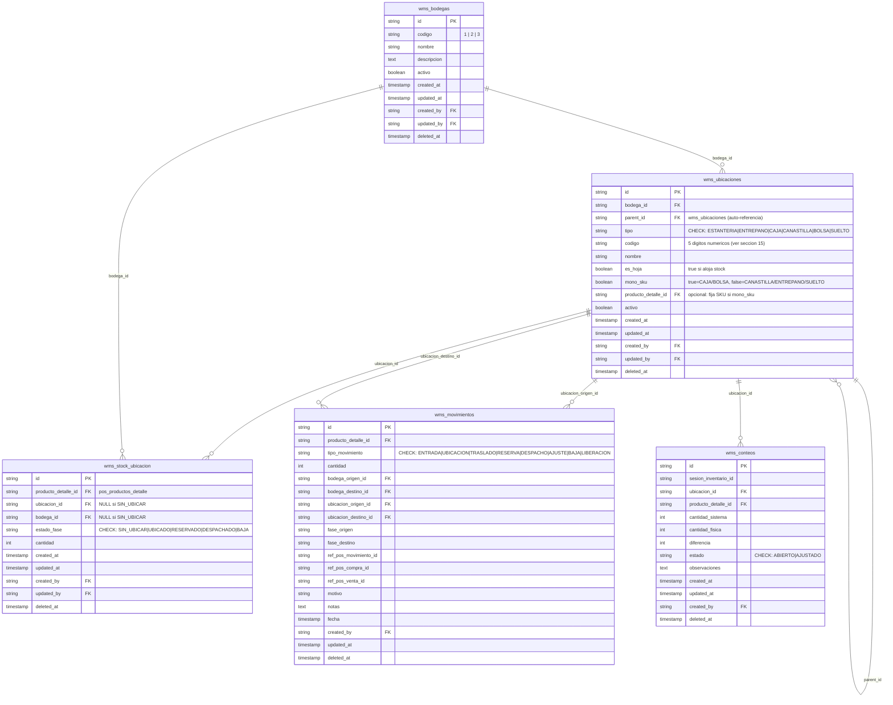

## Especificación del Módulo WMS - Kubit (Draft para SDD) — v6

> **Estado:** Especificación funcional cerrada. Nomenclatura de códigos definida (sección 15). Lista para montar en SDD.
> **Ubicación en el repo:** `specs/07-wms-spec.md` (el `06` está ocupado por `06-servicio-correo.md`).
> **Objetivo:** Alinear el WMS al modelo de ventas de Outletshop y al ecosistema Kubit (POS + Store)سobre Supabase.
>
> **Cambios v6:**
> - **Numeración corregida a `07`** (`07-wms-spec.md`); el DDL asociado será `08-wms-schema.sql`.
> - **Paleta UI Slate** (monocromático, modo oscuro por defecto), consistente con `05-ui-ux-system.md`.
> - Alineación con decisiones "No Reabrir" de Kubit: **estados como CHECK constraints con strings (no ENUMs)**, PK UUID v4, `timestamptz`, trigger `update_updated_at()`, RLS + grants explícitos.
> - Stack confirmado: **HTML + Tailwind (CDN) + JS vanilla + Supabase (PostgREST/.rpc())**. Sin frameworks SPA, sin build.

---

### 1. Descripción General

El módulo **WMS** (`apps/wms`) controla **la ubicación física de cada producto y su estado** dentro del almacén. Complementa, sin reemplazar, el inventario del POS.

- **POS = capa contable:** *"¿cuánto stock hay?"* → `pos_productos_detalle.stock_actual`.
- **WMS = capa física:** *"¿en qué bodega y contenedor está?"* → tablas `wms_*`.

El WMS es un **registro de ubicaciones sincronizado al stock del POS**: el POS manda el "cuánto"; el WMS administra el "dónde".

#### 1.1 Contexto físico (Outletshop)
**3 bodegas**, cada una con **dos formas de almacenamiento**:

| # | Bodega | Descripción |
|---|---|---|
| 1 | **Bodega Hogar/Limpieza** | Espacio del apartamento; **solo se gestiona el inventario de venta** (se ignoran los productos personales de limpieza). |
| 2 | **Mini Cuarto Útil** | Sector pequeño del apartamento. |
| 3 | **Cuarto Útil Grande** | Cuarto útil recién comprado, para crecer. |

**Dos paradigmas (coexisten en cada bodega):**
- **Estantería → Nivel/Entrepaño → Caja:** cada caja = 1 SKU (mono-SKU).
- **Canastilla → Bolsa:** canastilla = varios SKU (multi-SKU); bolsa = 1 SKU (mono-SKU); también admite producto **suelto**.

#### 1.2 Requerimientos
1. Ubicar productos en cualquier bodega/contenedor, **durante el Inventario general**, según necesidad.
2. Buscar un producto y darle salida desde su ubicación, o despacharlo **sin ubicar**.
3. **Mover productos entre bodegas y entre unidades de almacenamiento** (traslados).
4. Ajustarse al modelo de ventas de Outletshop.

#### 1.3 Alcance Funcional (MVP)
- Multi-bodega con árbol de contenedores (estantería/entrepaño/caja y canastilla/bolsa/suelto).
- Stock físico por contenedor y estado (`wms_stock_ubicacion`).
- **Inventario general**: contar y ubicar según necesidad.
- Movimientos: entrada lógica, ubicación, **traslado**, despacho, ajuste, baja por avería, liberación.
- Sincronización con POS por **lectura bajo demanda**.
- Búsqueda *"¿dónde está el SKU X?"* con ruta completa.
- Despacho **con o sin ubicación** previa.
- Reportes: stock por bodega/contenedor, contenedores vacíos, diferencias físicas vs. lógicas.

#### 1.4 Dependencias
- **DB:** Supabase (plan gratuito), esquema `public`; prefijo `wms_*`. Referencia `pos_productos_detalle`, `pos_usuarios`.
- **Stack:** HTML + Tailwind (CDN) + JavaScript vanilla + `supabase-js` (PostgREST). Transacciones vía funciones Postgres `.rpc()`. Sin frameworks SPA, sin TypeScript, sin build.
- **Catálogo:** el WMS **nunca crea productos**; solo referencia `producto_detalle_id`.
- **UI:** sistema de diseño Kubit (`05-ui-ux-system.md`): **monocromático Slate, modo oscuro por defecto**, **mobile-first / PWA**, **entrada manual** de códigos.
- **Infra:** Vercel (plan gratuito).

---

### 2. Arquitectura e Integración

#### 2.1 Fuente de verdad
| Dato | Fuente | Módulo |
|---|---|---|
| Catálogo, precios, stock total | `pos_productos*`, `pos_productos_detalle.stock_actual` | POS |
| Bitácora contable | `pos_movimientos_inventario` | POS |
| **Ubicación física / estado** | **`wms_stock_ubicacion`** | **WMS** |
| **Movimientos físicos** | **`wms_movimientos`** | **WMS** |

#### 2.2 Estados del stock en el WMS
| Estado | ¿`ubicacion_id`? | ¿Cuenta en `pos.stock_actual`? | Significado |
|---|---|---|---|
| `SIN_UBICAR` | **No (NULL)** | Sí | Existe en stock pero sin contenedor asignado. **Lógico, no físico.** |
| `UBICADO` | Sí | Sí | Asignado a un contenedor real. |
| `RESERVADO` | Opcional | No | Vendido en POS (marcado en la venta), pendiente de despacho. |
| `DESPACHADO` | — | No | Salió físicamente. |
| `BAJA` | — | No | Producto averiado retirado. |

> Los estados se almacenan como **strings con CHECK constraint** (no ENUMs), según convención de Kubit.
> Un producto recibido y vendido de inmediato viaja `SIN_UBICAR → RESERVADO → DESPACHADO` **sin pasar por ubicación física**.

#### 2.3 Invariante de reconciliación
```
pos_productos_detalle.stock_actual
   == SUM( wms_stock_ubicacion.cantidad )
      WHERE producto_detalle_id = X
        AND estado_fase IN ('SIN_UBICAR', 'UBICADO')
```

#### 2.4 Sincronización — MVP: lectura bajo demanda (sin triggers)
El WMS consulta al POS al abrir cada bandeja y **compara** `stock_actual` contra su conteo (`SIN_UBICAR + UBICADO`); las diferencias se resuelven en un panel de reconciliación. Idempotencia por `ref_pos_*`.

---

### 3. Jerarquía física (árbol de contenedores)
Árbol auto-referenciado (`wms_ubicaciones.parent_id`):
```
Bodega
  ├── Estantería → Entrepaño → Caja     (1 SKU por caja)
  └── Canastilla (varios SKU) → Bolsa   (1 SKU por bolsa)
                              └ Suelto   (producto sin bolsa dentro de la canastilla)
```
Stock `UBICADO` vive en el **contenedor hoja** (`es_hoja=true`). Cada contenedor lleva su `codigo` numérico (sección 15).

---

### 4. Modelo de Datos (`wms_*`)

#### 4.1 Convenciones (decisiones "No Reabrir" de Kubit)
Prefijo `wms_`; esquema `public`; PK UUID v4 (`gen_random_uuid()`); `timestamptz` default `now()`; `updated_at` vía trigger `update_updated_at()`; soft delete `deleted_at`; auditoría `created_by`/`updated_by` → `pos_usuarios`; FK indexadas; **estados como CHECK strings**; RLS + grants explícitos (`anon`, `authenticated`, `service_role`); catálogo por `producto_detalle_id`.

#### 4.2 Diagrama Entidad-Relación


#### 4.3 Catálogo de tablas (MVP)
| Tabla | Propósito |
|---|---|
| `wms_bodegas` | Las 3 bodegas |
| `wms_ubicaciones` | Árbol de contenedores |
| `wms_stock_ubicacion` | Stock físico por contenedor y estado (núcleo) |
| `wms_movimientos` | Bitácora de movimientos físicos |
| `wms_conteos` | Inventario general / ajustes |

---

### 5. Reglas de Negocio

#### 5.1 Contenedores
- `CAJA`/`BOLSA` = mono-SKU (fijan `producto_detalle_id` al recibir; libres al llegar a 0).
- `CANASTILLA` = multi-SKU; admite varias `BOLSA` y zonas `SUELTO`.
- `SUELTO` = zona lógica dentro de una canastilla para producto sin bolsa (multi-SKU permitido).
- Jerarquía: `BOLSA/SUELTO→CANASTILLA`; `CAJA→ENTREPANO→ESTANTERIA→bodega`; `CANASTILLA` cuelga de bodega.
- Sin control de capacidad ni bloqueos.

#### 5.2 Entrada (compra recibida en POS)
Al leer una compra `RECIBIDA` (nueva `entrada_compra`), el WMS incrementa el pool `SIN_UBICAR` del SKU (mov. `ENTRADA`). **No exige ubicar.**

#### 5.3 Ubicación (Inventario general o a demanda)
El usuario asigna `SIN_UBICAR → UBICADO` indicando el contenedor (mov. `UBICACION`). Un SKU puede repartirse en varios contenedores.

#### 5.4 Salida (venta en POS)
- Venta `CONFIRMADA` (nueva `salida_venta`) → WMS marca `RESERVADO` (mov. `RESERVA`), de `UBICADO` o `SIN_UBICAR`.
- Despacho (`RESERVADO → DESPACHADO`, mov. `DESPACHO`) **con o sin ubicación previa**; orden de salida indiferente.

#### 5.5 Anulación de venta en POS
Venta anulada (POS revierte stock) → WMS **libera** (mov. `LIBERACION`): `RESERVADO → UBICADO`/`SIN_UBICAR`.

#### 5.6 Traslados (entre bodegas y contenedores)
Mueve `UBICADO` de un contenedor a otro, misma bodega o **entre bodegas** (mov. `TRASLADO`). No cambia estado ni `stock_actual`.

#### 5.7 Ajustes de inventario del POS — impacto en el WMS
Las **devoluciones y correcciones** se hacen en POS con `ajuste_incremento`/`ajuste_decremento`; el WMS reacciona al leer el nuevo `stock_actual`:

| Ajuste en POS | Efecto | Acción del WMS |
|---|---|---|
| **Incremento (+)** | `stock_actual` sube | Agrega la diferencia al pool **`SIN_UBICAR`** (mov. `AJUSTE +`). |
| **Decremento (−)** | `stock_actual` baja | Retira la diferencia: primero de **`SIN_UBICAR`**; si no alcanza, pide de qué contenedor descontar lo `UBICADO` (mov. `AJUSTE −`). |

Sin aprobación (uso personal). Toda diferencia se muestra en el **panel de reconciliación**.

#### 5.8 Baja por avería
Producto dañado → `BAJA`, sale del contenedor y se **propaga al POS** como `merma` (descuenta `stock_actual`).

#### 5.9 Integridad (lección POS Fase 29)
Movimiento + efecto en `wms_stock_ubicacion` **atómicos** (función Postgres `.rpc()` transaccional); si falla un paso, se revierte todo. Nunca cantidad negativa. Reconciliación por SKU sumando 3 bodegas + `SIN_UBICAR`.

---

### 6. Flujos

**6.1 Recibir (sin obligar a ubicar):** `Compra RECIBIDA → +SIN_UBICAR`
**6.2 Ubicar:** `SIN_UBICAR → UBICADO (contenedor elegido)`
**6.3 Vender/Despachar:** `Venta CONFIRMADA → RESERVA → DESPACHO`; `Venta ANULADA → LIBERACION`
**6.4 Trasladar:** `TRASLADO ; UBICADO(origen) → UBICADO(destino)`
**6.5 Ajustar/Baja:** `POS ajuste (+/−) → reconcilia`; `Avería → BAJA + merma en POS`

---

### 7. UI/UX (páginas MVP, mobile-first, paleta Slate / modo oscuro)
1. **Dashboard** — SKU sin ubicar, pendientes por despachar, diferencias.
2. **Inventario general** — contar y **ubicar** (`SIN_UBICAR → UBICADO`).
3. **Buscar producto** — ruta completa bodega › contenedor › cantidad.
4. **Despachar** — ventas del POS; con o sin ubicación.
5. **Traslados** — mover entre contenedores/bodegas.
6. **Reconciliación** — resolver diferencias por ajustes del POS.
7. **Baja por avería**.
8. **Configuración** — alta de bodegas y contenedores (con sus códigos).
9. **Reportes**.

> Estilo: monocromático **Slate** (Tailwind), **modo oscuro por defecto** (`class="dark"` + anti-flash), header fijo `pt-16`, sidebar como POS, PWA con service worker (versioning `wms-YYYYMMDD-NN`, bypass localhost).

---

### 8. Integración Técnica
| Aspecto | Definición |
|---|---|
| **DB** | Supabase (gratuito); tablas `wms_*`; FK lógicas a `pos_*`. |
| **Stack** | HTML + Tailwind CDN + JS vanilla + `supabase-js`; transacciones vía funciones Postgres `.rpc()`. |
| **Sync (MVP)** | Lectura bajo demanda; idempotencia por `ref_pos_*`; panel de reconciliación. |
| **No-intrusión** | Solo lee `pos_*`; para ajustes/bajas inserta en `pos_movimientos_inventario`. |
| **RLS** | Habilitado por `bodega_id` + grants explícitos. |
| **Frontend** | **PWA**, **entrada manual** de códigos (sin lector). |

---

### 9. Roles (RBAC)
Hoy **uso personal (un admin)**. Previstos: `wms_admin`, `wms_operario`, `wms_consulta` (reutiliza `pos_roles`/`pos_permisos`).

---

### 10. Plan por Fases
- **Fase 0:** montar SDD + estructura `apps/wms`.
- **Fase 1 (MVP):** tablas núcleo; Inventario general; ubicar; buscar; despachar (con/sin ubicación); traslados; ajustes/reconciliación; baja.
- **Fase 2:** automatización (triggers/Edge Functions), órdenes de trabajo.
- **Fase 3:** mapa de bodegas, reportes de ocupación, escaneo por cámara (PWA).

---

### 11. Set de Pruebas (vitest + jsdom, patrón del repo)
- Recibir → +`SIN_UBICAR`; `stock_actual` intacto.
- Ubicar → `SIN_UBICAR → UBICADO`; un SKU en varios contenedores.
- Recibido→vendido inmediato → `SIN_UBICAR → RESERVADO → DESPACHADO` sin ubicar.
- Anular venta → liberación.
- Traslado B1→B3 → total y POS intactos.
- Ajuste + → entra a `SIN_UBICAR`; Ajuste − → sale de `SIN_UBICAR`/contenedor.
- Baja → `BAJA` + `merma` en POS.
- Reconciliación → `SUM(SIN_UBICAR+UBICADO) == stock_actual`.
- Atomicidad → si falla el update, se revierte el movimiento.
- Códigos → validar formato de 5 dígitos y rangos (sección 15).

---

### 12. Decisiones — estado
| # | Decisión | Estado |
|---|---|---|
| 1 | Multi-bodega | ✅ 3 bodegas |
| 2 | Sync MVP | ✅ Lectura bajo demanda |
| 3 | Reserva | ✅ En la venta |
| 4 | Detalle de ubicación | ✅ Árbol Estantería→Entrepaño→Caja y Canastilla→Bolsa/Suelto |
| 5 | FIFO/FEFO | ✅ No aplica |
| 6 | Calidad | ✅ Solo primera; avería → BAJA |
| 7 | Ajustes | ✅ Sin aprobación |
| 8 | Traslados | ✅ Entre bodegas y contenedores |
| 9 | Carga inicial | ✅ No masiva; vía Inventario general |
| 10 | SKU multi-ubicación | ✅ Permitido |
| 11 | Despacho sin ubicar | ✅ Permitido (`SIN_UBICAR` lógico) |
| 12 | Anulación libera reserva | ✅ Sí |
| 13 | Devoluciones | ✅ Fuera del MVP (vía ajuste POS, ver 5.7) |
| 14 | Unidad de medida | ✅ Unidades sueltas |
| 15 | Bodega 1 personal | ✅ Se ignora lo personal |
| 16 | Capacidad/bloqueos | ✅ No se gestionan |
| 17 | Entrada de datos | ✅ Manual, mobile-first |
| 18 | Nomenclatura | ✅ Numérica 5 dígitos `B CC PP` (sección 15) |
| 19 | Stack / UI | ✅ HTML+Tailwind CDN+JS vanilla; paleta **Slate**, modo oscuro |
| 20 | Numeración en specs/ | ✅ `07-wms-spec.md` (06 ocupado por servicio-correo) |

---

### 13. Glosario
| Término | Definición |
|---|---|
| **SIN_UBICAR** | Stock que existe pero aún no tiene contenedor (estado lógico) |
| **UBICADO** | Stock asignado a un contenedor real |
| **RESERVADO / DESPACHADO** | Vendido pendiente de salida / salido físicamente |
| **BAJA** | Producto averiado retirado |
| **SUELTO** | Producto dentro de una canastilla sin bolsa |
| **Contenedor** | Estantería, entrepaño, caja, canastilla, bolsa o zona suelta |
| **Reconciliación** | Igualar stock físico (WMS) con contable (POS) |

---

### 15. Estándar de Nomenclatura de Códigos (OFICIAL)

**Objetivo:** códigos **cortos, 100% numéricos** (cero cambios de teclado en el móvil), fáciles de escribir con marcador y de digitar en el celular.

#### 15.1 Formato
```
B CC PP   →  5 dígitos, todo numérico

B   = bodega            1–9        (1=Hogar/Limpieza, 2=Mini Cuarto Útil, 3=Cuarto Útil Grande)
CC  = contenedor        01–50 canastilla · 51–99 entrepaño de estantería
PP  = posición:
        en canastilla → 01–90 bolsa · 91–99 suelto (sub-zonas dentro de la canastilla)
        en entrepaño  → 01–99 caja
        00            → referencia al contenedor completo (traslado de toda la canastilla/entrepaño)
```

#### 15.2 Ejemplos
| Código | Significado |
|---|---|
| `20110` | Bodega 2 · Canastilla 01 · Bolsa 10 |
| `30191` | Bodega 3 · Canastilla 01 · Suelto (zona 91) |
| `35905` | Bodega 3 · Entrepaño 59 · Caja 05 |
| `30100` | Bodega 3 · Canastilla 01 completa (referencia) |

> Ejemplo SKU **AL048**: en bolsa 10 de la canastilla 01 (bodega 3) → `30110`; suelto en esa canastilla → `30191`.

#### 15.3 Por qué esta opción
- **Un solo teclado (numérico):** digitación muy rápida en móvil.
- **Longitud fija (5 dígitos):** validación trivial, menos errores.
- **Único global:** la bodega va incrustada; `20110` no se repite en otra bodega.
- **Autodescriptivo por rango:** el rango indica canastilla/entrepaño y bolsa/suelto sin letras.
- **En el adhesivo escribes exactamente el número** con marcador.

#### 15.4 Reglas técnicas (blindaje ante crecimiento)
1. **`wms_ubicaciones.tipo` es la fuente de verdad** (CANASTILLA/ENTREPANO/BOLSA/CAJA/SUELTO). El rango numérico es **solo ayuda visual**: si un número se sale del rango por necesidad futura, **los datos no se corrompen**.
2. **Un código de "suelto" (91–99) puede alojar varios SKU** a la vez: el WMS los distingue por `producto_detalle_id`. Con un solo código de suelto (ej. `91`) basta; los 92–99 son sub-zonas físicas **opcionales**.
3. **Límite a vigilar:** máximo **50 canastillas por bodega** (rango 01–50) — único techo con probabilidad real de tocarse en la Bodega 3. Mitigación: en bodegas **solo de canastillas** (sin estantería) el rango se puede ampliar a 01–99, ya que `tipo` manda sobre el rango.
4. La app **reconstruye la ruta completa** desde `parent_id`; el usuario solo digita el código de 5 dígitos.

#### 15.5 Capacidad del esquema vs. inventario actual
| Segmento | Máximo | Uso actual | Estado |
|---|---|---|---|
| Bodegas | 9 | 3 | ✅ Amplio |
| Canastillas / bodega | 50 | < 50 | ⚠️ Vigilar en B3 |
| Entrepaños / bodega | 49 (51–99) | 1 estantería | ✅ Amplio |
| Bolsas / canastilla | 90 (01–90) | pocas | ✅ Amplio |
| Sueltos / canastilla | 9 (91–99) | pocos | ✅ Suficiente |
| Cajas / entrepaño | 99 | 30–40 total | ✅ Amplio |
